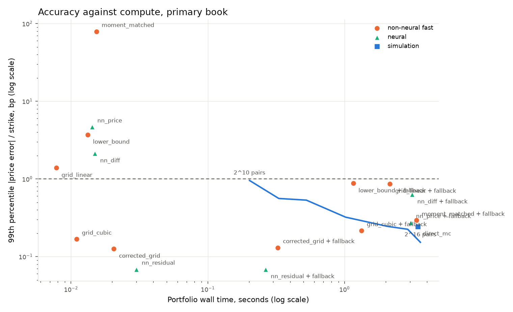
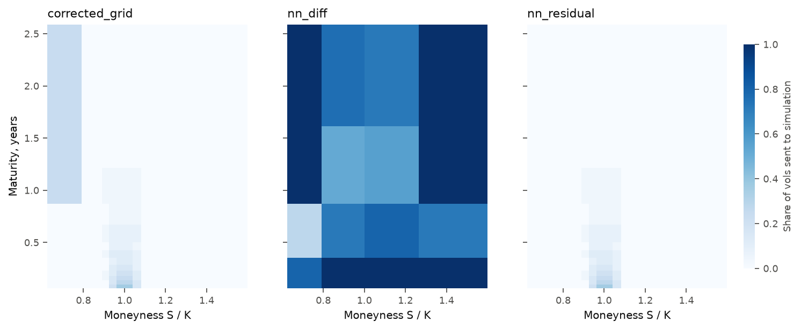

# Benchmark report

Every number here comes from the sealed run in `results/run`, measured on one Apple M5 Pro at commit `1dc8022`. `results/run/tables.md` has the full generated tables, and `results/run/raw` has the measurements. Rebuild them with `make report`.

## The answer

**Neither hypothesis holds.** Can a small neural network with simulation fallback beat the fastest credible baseline at the same accuracy, on the whole portfolio job? No. The frozen rule, applied in code, gives this:

| | Route | Passes the gate | Wall time | Against the comparator |
|---|---|---|---:|---:|
| Comparator | Cubic grid, no fallback | Yes | 11.0 ms | |
| Primary hypothesis | `nn_diff` with fallback | Yes | 3.11 s | 283 times slower. Not supported |
| Secondary hypothesis | `nn_residual` with fallback | Yes | 264 ms | 24 times slower. Not supported |
| Stretch target | Ten times faster than the comparator | | | Not reached |

The fixed job is 500 contracts by 42 shock scenarios, or 21,000 repricings. The gate is a p99 price error of at most 1 bp of strike and a p99 delta error of at most 0.001.

## Primary book

Five runs, each pairing one network seed with one simulation seed. Wall time is the mean of the runs, each the median of 3 repeats. Errors are the median across runs, and the worst request is the largest from any run.

| Route | Wall time (s) | Sd (s) | Requests/s | Median price (bp) | p99 price (bp) | Worst price (bp) | Median delta | p99 delta | Worst delta | Sent to simulation | Passes |
|---|---:|---:|---:|---:|---:|---:|---:|---:|---:|---:|---|
| grid_linear | 0.0078 | 0.0015 | 2,691,353 | 0.432 | 1.386 | 3.91 | 0.00015 | 0.00128 | 0.00812 | 0.0% | No |
| **grid_cubic** | **0.0110** | 0.0005 | 1,909,648 | 0.011 | 0.168 | 0.50 | 0.00013 | 0.00076 | 0.00534 | 0.0% | Yes |
| lower_bound | 0.0132 | 0.0015 | 1,586,710 | 0.168 | 3.713 | 8.65 | 0.00003 | 0.00051 | 0.00104 | 0.0% | No |
| nn_price | 0.0143 | 0.0024 | 1,473,118 | 0.589 | 4.674 | 49.25 | 0.00083 | 0.01258 | 0.10890 | 0.0% | No |
| nn_diff | 0.0150 | 0.0033 | 1,404,395 | 0.304 | 2.132 | 16.54 | 0.00044 | 0.00404 | 0.04227 | 0.0% | No |
| moment_matched | 0.0153 | 0.0019 | 1,369,632 | 3.425 | 79.092 | 163.41 | 0.00238 | 0.01740 | 0.02540 | 0.0% | No |
| corrected_grid | 0.0205 | 0.0023 | 1,023,013 | 0.008 | 0.126 | 0.33 | 0.00008 | 0.00051 | 0.00104 | 0.0% | Yes |
| nn_residual | 0.0301 | 0.0080 | 697,773 | 0.010 | 0.069 | 0.19 | 0.00002 | 0.00011 | 0.00041 | 0.0% | Yes |
| nn_residual + fallback | 0.2642 | 0.1903 | 79,478 | 0.010 | 0.069 | 0.19 | 0.00002 | 0.00013 | 0.00041 | 1.4% | Yes |
| corrected_grid + fallback | 0.3240 | 0.0403 | 64,806 | 0.008 | 0.130 | 0.60 | 0.00008 | 0.00052 | 0.00164 | 2.0% | Yes |
| lower_bound + fallback | 1.1552 | 0.1573 | 18,179 | 0.074 | 0.876 | 1.75 | 0.00003 | 0.00084 | 0.00164 | 24.8% | Yes |
| grid_cubic + fallback | 1.3292 | 0.0865 | 15,799 | 0.011 | 0.216 | 0.95 | 0.00014 | 0.00082 | 0.00164 | 21.6% | Yes |
| grid_linear + fallback | 2.1405 | 0.4557 | 9,811 | 0.173 | 0.867 | 1.09 | 0.00013 | 0.00068 | 0.00164 | 41.9% | Yes |
| nn_price + fallback | 3.0431 | 0.2481 | 6,901 | 0.008 | 0.275 | 1.64 | 0.00016 | 0.00087 | 0.00164 | 99.4% (97.9% to 100.0%) | Yes |
| nn_diff + fallback | 3.1095 | 0.2196 | 6,753 | 0.008 | 0.632 | 1.57 | 0.00016 | 0.00087 | 0.00280 | 87.8% (74.8% to 100.0%) | Yes |
| moment_matched + fallback | 3.3498 | 0.7776 | 6,269 | 0.008 | 0.293 | 6.15 | 0.00016 | 0.00094 | 0.00241 | 98.2% | Yes |
| direct_mc | 3.4193 | 0.4510 | 6,142 | 0.008 | 0.244 | 0.95 | 0.00016 | 0.00087 | 0.00164 | 100.0% | Yes |

Sample standard deviation across runs in the p99 errors: 0.244 bp and 0.00004 delta for `nn_diff` with fallback, 0.013 bp and 0.00002 for `nn_residual` with fallback. Grids and closed forms have no seed, so their spread is near zero. Shares sent to simulation depend on the network seed, so the table gives their range. In one `nn_diff` run the rule accepted nothing.

## Why the networks lost

These are explanations of the measurements. The run did not test them as causes.

1. **The problem has three inputs.** Homogeneity reduces each request to log moneyness, vol and maturity, and the price is smooth almost everywhere on that box. That suits a table, and a 9,537 node grid passed the gate. A network may do better in many dimensions, and this project does not test that.
2. **Fallback has a fixed entry price.** A hybrid builds simulation paths as soon as one request falls back, and requests near the payoff kink always fall back. That added about 0.14 s to `nn_residual` in its fastest run, against 11 ms for the whole job on the cubic grid.
3. **The raw network is too rough for its fallback rule.** `nn_diff` alone has a p99 delta error of 0.00404, four times the tolerance, so 87.8% of requests went to simulation. At 3.11 s it cannot be told apart from direct simulation at 3.42 s: the gap is 0.31 s, and the spreads are 0.22 and 0.45 s.

## What did work

These are observations, not hypotheses. The freeze did not rule on them.

**Learning the correction beat everything on accuracy.** `nn_residual` learns the gap between the price and a closed-form lower bound. With no fallback at all it has the lowest error of any route on the book: p99 0.069 bp and 0.00011 delta. Its worst of 21,000 requests missed by 0.19 bp and 0.0004 delta. With and without fallback, it is the only route whose worst request sits clearly inside both tolerances. It takes 30.1 ms, 114 times faster than simulation, but it is still 2.7 times slower than the comparator.

**The fastest route is the brittle one.** The gate reads the p99, so it lets a route hide 1% of requests. The cubic grid's worst delta error is 0.0053, five times the tolerance. Corrected grid and the lower bound reach 0.00104, just over it. Stress makes this plainer:

| Route, no fallback | Near expiry p99 price (bp) | Near expiry p99 delta | Kink p99 price (bp) | Kink p99 delta |
|---|---:|---:|---:|---:|
| grid_cubic | 227.524 | 0.21868 | 0.614 | 0.01492 |
| grid_linear | 228.114 | 0.21539 | 3.647 | 0.01016 |
| nn_diff | 50.298 | 0.20309 | 16.197 | 0.05751 |
| nn_price | 76.193 | 0.26925 | 48.754 | 0.13473 |
| corrected_grid | 0.050 | 0.00028 | 0.002 | 0.00020 |
| nn_residual | 0.040 | 0.00010 | 0.007 | 0.00009 |
| lower_bound | 0.033 | 0.00009 | 0.006 | 0.00009 |

Stress sets are reported apart from ordinary traffic, and each has 2,500 points. Near-expiry points lie below the fitted maturities, so this is extrapolation. The fallback rule sends every stress point to simulation, which gives p99 0.005 bp and 0.00037 delta near expiry, and 0.001 bp and 0.00038 at the kink. The lower bound alone is already this accurate on both stress sets, so the correction network adds nothing there. It only has to avoid spoiling the bound, and it does.

If I had to run this book, I would use the corrected grid. It is 1.9 times slower than the cubic grid, is cheap to build, and it holds up under stress.

**Delta labels help, on equal paths.** With both arms on the same paths and 58,000 steps:

| Training points | Paths per point | Price only: p99 price (bp), p99 delta | Price and delta: p99 price (bp), p99 delta |
|---:|---:|---:|---:|
| 1,500 | 32,768 | 4.47, 0.00884 | 1.91, 0.00315 |
| 6,000 | 32,768 | 4.57, 0.00884 | 1.71, 0.00310 |
| 24,000 | 32,768 | 4.25, 0.00883 | 1.79, 0.00311 |

Delta supervision cut price error about 2.5 times and delta error about 2.8 times, and it did so at 1,500 points. More points changed almost nothing, which suggests its size or training steps limit this network, not its data. Neither arm got below 1.71 bp. Each row is the mean of 3 seeds on the sealed test.

## Fallback

The fallback rule splits the box into 64 cells and accepts a cell only if the rank `ceil((n + 1) * 0.99)` of its calibration errors is within tolerance. Requests in the kink region always go to simulation.

The heatmap shows run 0 only, which is the most favorable seed for `nn_diff`: its book fallback rate was 74.8% there and 100% in run 2.

The sealed ordinary test has 20,000 points. Means across seeds:

| Route | No fallback: median, p99 price (bp) | No fallback: median, p99 delta | Accepted points: p99 price (bp), p99 delta | With fallback: p99 price (bp), p99 delta | Sent to simulation |
|---|---:|---:|---:|---:|---:|
| corrected_grid | 0.011, 0.200 | 0.00008, 0.00059 | 0.192, 0.00056 | 0.230, 0.00063 | 2.0% |
| grid_cubic | 0.015, 0.310 | 0.00013, 0.00087 | 0.218, 0.00074 | 0.341, 0.00099 | 27.1% |
| grid_linear | 0.341, 1.231 | 0.00015, 0.00096 | 0.886, 0.00060 | 0.860, 0.00088 | 35.8% |
| lower_bound | 0.190, 5.686 | 0.00005, 0.00079 | 0.813, 0.00023 | 0.771, 0.00099 | 33.0% |
| nn_diff | 0.293, 1.757 | 0.00041, 0.00288 | 0.941, 0.00102 | 0.599, 0.00102 | 88.5% |
| nn_price | 0.530, 3.932 | 0.00086, 0.00780 | 1.015, 0.00126 | 0.481, 0.00104 | 99.0% |
| nn_residual | 0.014, 0.125 | 0.00004, 0.00031 | 0.125, 0.00031 | 0.125, 0.00031 | 0.0% |

`nn_diff` accepted points exist in 4 of 5 seeds, with p99 delta 0.00085 to 0.00116. `nn_price` accepted points exist in 2 of 5 seeds. Their accepted columns average only those seeds.

For scale, `direct_mc` alone on this set has a p99 of 0.357 bp and 0.00102 delta, so simulation at the chosen size sits on the delta tolerance. That is why a hybrid can miss 0.001 here even with a perfect fast method.

## Failure specimen

This is the worst answer `nn_diff` with seed 0 gave on a point its rule accepted, on the sealed test. Seed 0 is the mildest case. Across seeds, the worst accepted delta error ranged from 0.00124 to 0.00179, and the worst accepted price error from 0.92 to 1.72 bp.

| | Value |
|---|---|
| Point | ln(S/K) = -0.16666, vol = 0.24455, T = 1.00243 |
| Reference delta | 0.175615 +/- 0.000072 |
| `nn_diff` delta | 0.176857, off by 0.001242, or 1.24 tolerances |
| `nn_residual` delta | 0.175753, off by 0.000138 |

The rule accepted a wrong answer, and it was allowed to. Its guarantee is joint: the chance that a cell is accepted and a point in it misses is at most 1%. It does not promise 99% among accepted points. The accepted p99 of 0.00102 above shows that gap.

Unsupported points fail far harder if you skip the rule. At ln(S/K) = 0.01104, vol = 0.08676, T = 0.0132, `nn_diff` gave delta 0.584820 against 0.967252, or 382 tolerances. The rule sent that point to simulation.

## Latency and throughput

Median over 300 requests, one at a time, including the routing decision, and over 30 requests for `direct_mc`. This is Python call overhead, so read it as an order of magnitude.

| Route | Latency |
|---|---:|
| grid_cubic | 29 us |
| nn_diff | 49 us |
| lower_bound | 85 us |
| nn_residual | 121 us |
| corrected_grid | 158 us |
| direct_mc, paths built | 4.93 ms |
| direct_mc, building paths | 3.16 ms |

The whole-job order differs from the single-request order because batches favor vectorized work. The cubic grid reached 1.9 million requests per second, and tuned simulation reached 6,142.

## Upfront cost and payback

Upfront wall time is labeling plus training, and hybrid routes add 186 s to label the calibration set. Network training uses the fastest of 5 seeds, because other work on the machine only ever adds time. One job is 21,000 queries.

| Route | Label wall (s) | Train wall (s) | Calibrate wall (s) | Upfront wall (s) | Saves per job vs direct (s) | Jobs to recover vs direct | Queries to recover vs direct | Saves per job vs comparator (s) | Jobs to recover vs comparator |
|---|---:|---:|---:|---:|---:|---:|---:|---:|---:|
| grid_cubic | 39 | 0 | 0 | 39 | 3.408 | 11.6 | 243,043 | Comparator | Comparator |
| corrected_grid | 7 | 0 | 0 | 7 | 3.399 | 2.0 | 41,514 | -0.0095 | Never |
| nn_residual | 4 | 80 | 0 | 84 | 3.389 | 24.8 | 520,231 | -0.0191 | Never |
| nn_residual + fallback | 4 | 80 | 186 | 270 | 3.155 | 85.7 | 1,799,778 | -0.2532 | Never |
| corrected_grid + fallback | 7 | 0 | 186 | 193 | 3.095 | 62.4 | 1,310,510 | -0.3130 | Never |
| nn_diff + fallback | 21 | 457 | 186 | 665 | 0.310 | 2,147.9 | 45,105,213 | -3.0985 | Never |

Never means savings are not positive, so no number of jobs pays the cost back.

## Bespoke book

The bespoke book uses whole-day maturities, so 2,898 vol and maturity pairs replace 576, and simulation can share less work. It is a sensitivity run and does not change the verdict.

| Route | Wall time (s) | p99 price (bp) | p99 delta | Sent to simulation |
|---|---:|---:|---:|---:|
| grid_cubic | 0.0097 | 0.149 | 0.00073 | 0% |
| corrected_grid | 0.0147 | 0.112 | 0.00050 | 0% |
| nn_residual | 0.0213 | 0.056 | 0.00011 | 0% |
| nn_residual + fallback | 0.4312 | 0.056 | 0.00012 | 0.8% |
| nn_diff + fallback | 12.61 | 0.566 | 0.00082 | 88.8% |
| direct_mc | 12.82 | 0.194 | 0.00083 | 100% |

Direct simulation slows down 3.7 times. Grids do not notice, which makes the gap to simulation 1,322 times here.

## Correctness evidence

| Check | Result |
|---|---|
| Tests | 110 passed, 92% line coverage, on the final code |
| QuantLib, arithmetic | 24 random contracts, largest gap 2.36 standard errors, 92% within 2 |
| QuantLib, geometric formula | Largest gap 1.6e-14 |
| Simulation efficiency | The conditional control beats plain Monte Carlo by 5,723 to 476,425 times on 4 panel contracts |
| Book reference | 8 independent replicates of 2^19 antithetic pairs. Standard error: median 0.0012 bp and max 0.039 bp on price, median 0.000021 and max 0.00008 on delta |
| Label noise | 2,000 sealed points relabeled with new seeds: p99 gap 0.12 bp and 0.00034 delta |
| Path reuse | 20.6 times faster per query after one sort, on 64 requests at 2^15 pairs |
| Network delta | Checked against autograd in the tests |

Direct simulation on the GPU took 1.43 s in 32-bit, against 2.56 s on six CPU threads in 64-bit, median of 3 repeats. Price moved by at most 0.0044 bp. The verdict uses 64-bit on the CPU, as frozen. The GPU would not change the verdict, since the comparator is 130 times faster than that.

## What the numbers leave out

- **One machine with other work on it.** Load average was 9 to 16 on 18 cores during the primary book, and higher before the run. Timings are noisy, and the spread across runs includes that noise. Treat ratios as better evidence than absolute times.
- **One spike is in the data.** `nn_residual` with fallback took 0.603 s in run 1, against 0.161 to 0.205 s in the others, which explains its large spread. It stays in, as the rule requires. Its fastest run is still about 15 times slower than the comparator.
- **Thread counts differ.** Closed forms and grids use one NumPy thread and PyTorch uses six, as frozen. This helps networks and simulation, not grids or closed forms. CPU seconds are in `results/run/tables.md`.
- **Route order was only partly shuffled.** The freeze says route order is shuffled per run. Surfaces were shuffled, but direct simulation ran first in all 5 runs, and each hybrid ran right after its own fast route.
- **Python everywhere.** A compiled grid or a batched network would change the constants, and the single-request numbers most of all.
- **Upfront cost leaves things out.** It omits validation labels, tuning and discarded experiments.
- **The gate reads the p99.** A route can pass while 1% of requests are worse. That is why the worst request is reported.
- **The hypotheses were close to forced.** A dry run on the development book showed the fixed cost of fallback before the freeze. The freeze did not change the hypotheses because of it, and a neural route without fallback was never a hypothesis.
- **The test used one fixed rate and 12 fixings.** Both are constants of the experiment, not inputs. A model that also varies rate, fixing count or history has more dimensions and might favor a network. That is a future target, and nothing here measures it.
- **The model is geometric Brownian motion.** The claim is numerical accuracy under that model. It says nothing about market prices, skew, jumps or moving rates.
- **The contracts are at inception.** There is no fixing history. All inputs are synthetic.
- **Training times are noisy.** Network fits ran under load, with pauses, and some with other projects on the machine.
- **Defects were fixed before the freeze.** Fallback bins and the differential step count changed on development data, before any sealed label existed.

Failed experiments are in [research-notes.md](research-notes.md). The frozen plan is `results/freeze.json`, and the plan's text is `configs/freeze_statement.json`.
